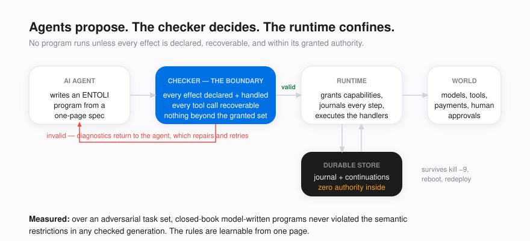
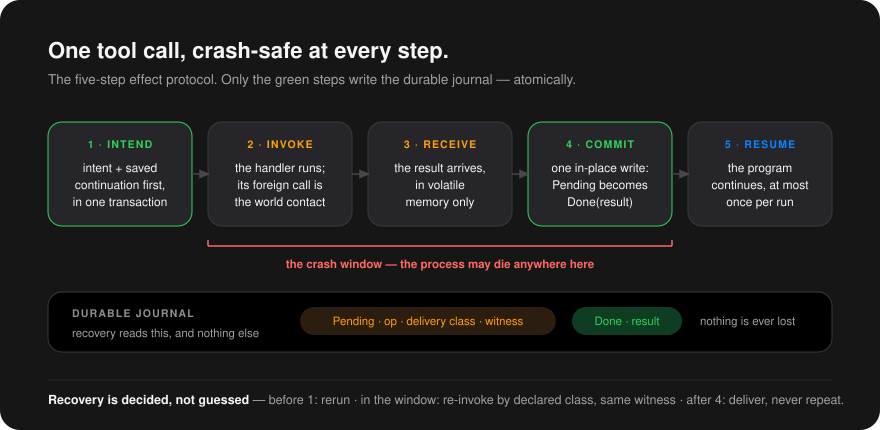
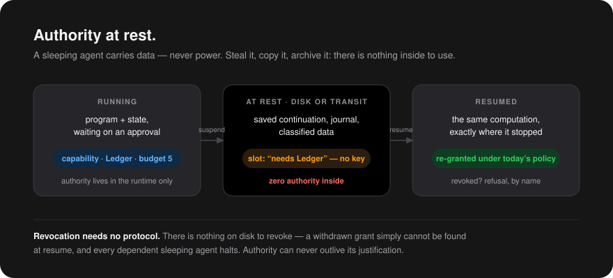
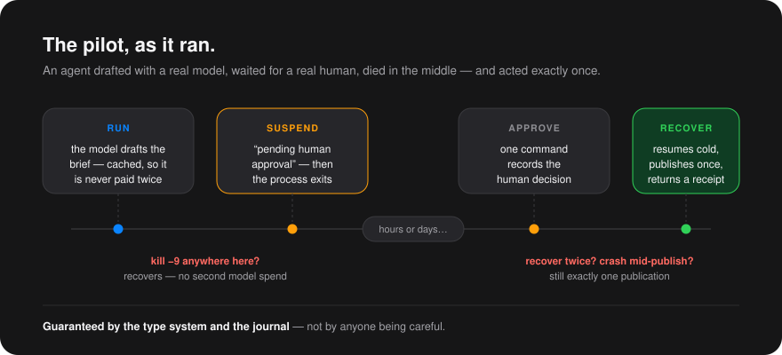

# ENTOLI

**A programming language where surviving a crash, acting exactly once, and
holding only granted authority are properties of the type system — not of
discipline.**

ENTOLI is a small language and runtime for programs that act on the real
world and cannot afford to get it wrong: agents that call models, wait days
for a human decision, and then publish, pay, or deploy. An ENTOLI program
survives `kill -9` at any instruction, resumes cold — in a new process, on a
new machine — exactly where it stopped, and never silently repeats or loses
an external effect.

Consider what that takes today. An agent that drafts with an LLM, suspends
for human approval, and posts the result needs a workflow engine for
durability, idempotency keys and retry wrappers for exactly-once delivery,
and careful credential hygiene so that a snapshot of the sleeping agent
cannot be stolen and replayed with its secrets inside. Three guarantees,
three separate subsystems, held together by engineering care. ENTOLI derives
all three from one mechanism — **typed algebraic effect handlers with
one-shot continuations**:

- every external operation is a declared **effect**, journaled together with
  the program's saved continuation *before* the world is contacted;
- every operation carries its **recovery contract in its type** — a program
  that performs an effect it cannot recover does not compile;
- **capabilities are runtime-only values with no serialized form** — what
  sleeps on disk is data with zero power.

This is a complete durable workflow in ENTOLI — the pilot this repository
ships and tests ([`pilot/brief.ent`](pilot/brief.ent)):

```text
effect Infer    suspending { complete : Str -> Str  @at_least_once }
effect Approval suspending { request  : Str -> Data @at_least_once }
effect Publish  suspending { post     : Str -> Str  @at_least_once }

def brief : Str -[Infer, Approval, Publish]-> Data =
  fn topic ->
    let draft = do Infer.complete(concat("Write a crisp 150-word brief on: ", topic))
                witness concat("draft:", topic) in
    match do Approval.request(draft) witness concat("gate:", topic) {
      approve() -> Published(do Publish.post(draft) witness concat("pub:", topic))
      reject()  -> Halted(topic)
    }
```

No queue, no state machine, no retry wrapper — plain sequential code. Yet:
kill the process mid-draft and recovery replays under the same witness, so
the model is never paid twice; the approval can take a week with nothing
running and no credential on disk; crash during publish and recover as many
times as you like — the post still happens exactly once. All of it follows
from the three type annotations above.

ENTOLI is designed to be **written by models and verified by a checker**:
agents propose programs, the checker is the hard boundary, and only valid
programs execute.



## The three guarantees

**Nothing is lost.** Every external operation runs through a five-step
protocol that journals intent — and the saved continuation — *before* any
contact with the world. A crash at any point leaves a store from which exactly
one recovery action follows.



**Nothing happens twice.** Every operation declares how it recovers
(`@idempotent`, `@at_least_once` with a witness, `@compensable`). A program
that performs an unrecoverable effect does not compile. Recovery re-invokes
under the recorded witness; services deduplicate; results already committed
are delivered, never re-executed.

**Authority cannot sleep.** Capabilities never cross the durable boundary. A
suspended agent on disk — or in transit — contains data and *zero* power;
resuming re-grants under whatever policy holds *now*. Revocation is not a
protocol; it is an absence.



## Getting started

All you need is a [Rust toolchain](https://rustup.rs) (stable). SQLite is
bundled — there are no system dependencies.

```sh
git clone https://github.com/PillarDelta/entoli.git
cd entoli
cargo build --release -p entoli-cli

# the full crash/recovery suite ships in-tree
cargo test --workspace
```

The binary lands at `./target/release/entoli-cli`; the walkthrough below uses
it as `$B`.

## Seen end to end

The pilot in [`pilot/brief.ent`](pilot/brief.ent): a model drafts a brief, a
human approves it — with the process dead in between, for as long as it takes
— and the result is published exactly once.



```sh
B=./target/release/entoli-cli

# run: the draft happens, the human gate suspends, the process exits
$B run pilot/brief.ent --dir pilot-store \
  --grant Infer --grant Approval --grant Publish \
  --bind "llm_svc=echo:Infer.complete" \
  --bind "approval_svc=approve:Approval.request" \
  --bind "publish_svc=ledger:Publish.post"

# whenever the human decides — minutes or days later
$B approve --dir pilot-store \
  --witness "gate:durable execution for AI agents" --decision approve

# recover cold: completes, publishes exactly once
$B recover pilot/brief.ent --dir pilot-store \
  --grant Infer --grant Approval --grant Publish \
  --bind "llm_svc=echo:Infer.complete" \
  --bind "approval_svc=approve:Approval.request" \
  --bind "publish_svc=ledger:Publish.post"
```

Swap `echo` for the real model binding
(`--bind "llm_svc=llm:Infer.complete:<model>"`, key via environment) and
`ledger` for a real webhook (`--bind "publish_svc=http:Publish.post:<url>"`)
— see [`docs/pilot-runbook.md`](docs/pilot-runbook.md). Kill the process at
any step; `recover` completes with exactly-once effects. The crash matrix is
pinned by the test suite.

## What is established, measured, and open

- **Proved** (formal machine, [`docs/metatheory-v0.6.md`](docs/metatheory-v0.6.md)):
  preservation of the store invariant; recovery-action selection computable
  from the store alone; authority at rest.
- **Tested under hard process death**: kill-and-recover at every protocol
  step; revocation while sleeping; compatibility drift quarantine; the full
  suite ships in-tree.
- **Measured**: in a two-round adversarial study, closed-book model-written
  programs never violated the semantic restrictions in any checked generation
  (corpus in [`docs/convergence-study-2026-11-08/`](docs/convergence-study-2026-11-08/));
  per-effect runtime cost is flat as the journal grows
  ([`docs/bench-2026-11-09-post-T3.csv`](docs/bench-2026-11-09-post-T3.csv)).
- **Open, recorded**: every known gap and deliberate deferral is in
  [`docs/EVALUATION.md`](docs/EVALUATION.md) and
  [`docs/production-roadmap.md`](docs/production-roadmap.md). This is a
  research-grade reference implementation on its way to production, and its
  claims are calibrated accordingly.

## The paper

The working paper is [`paper/ENTOLI_V3.pdf`](paper/ENTOLI_V3.pdf) —
semantics, theorems, the authorship study, and the evaluation. A companion
position paper on a network of mobile ENTOLI agents over attested hosts is
[`paper/capsule-network.tex`](paper/capsule-network.tex).

## Repository map

| Path | Contents |
|---|---|
| `crates/entoli-syntax` | AST, effect/delivery/suspension declarations |
| `crates/entoli-core` | CEK-style evaluator, one-shot continuations |
| `crates/entoli-encode` | closed codec, content addressing, sharing-preserving encoding |
| `crates/entoli-store` | durable store (SQLite), journal, invariants |
| `crates/entoli-runtime` | the five-step protocol, grants, recovery execution |
| `crates/entoli-recovery` | the recovery driver, generated as ENTOLI terms |
| `crates/entoli-check` | parser and static checker (the boundary) |
| `crates/entoli-cli` | `compile` / `run` / `approve` / `recover` |
| `pilot/`, `docs/` | the pilot program, papers' evidence, roadmap, findings register |

---

Copyright © 2026 Pillar Delta PC. All rights reserved. See [LICENSE](LICENSE).
